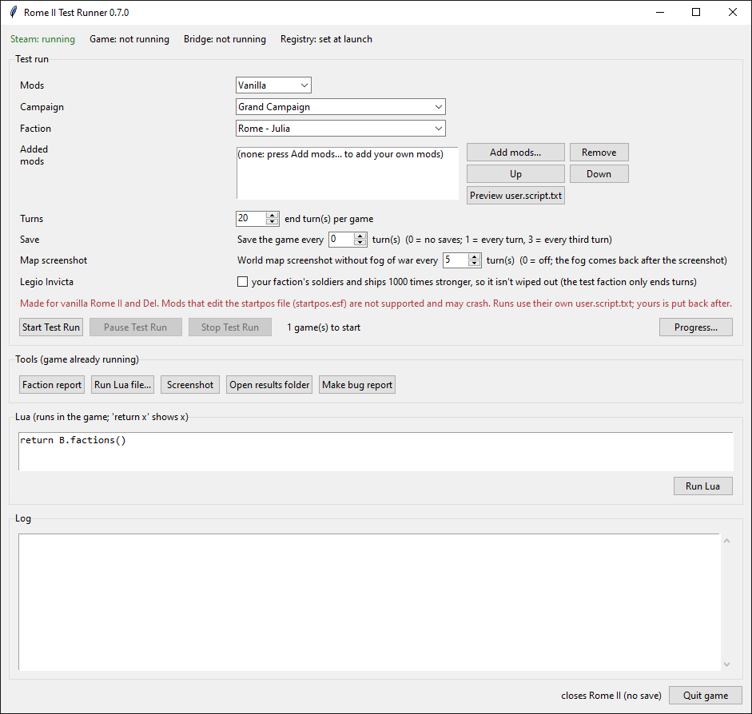
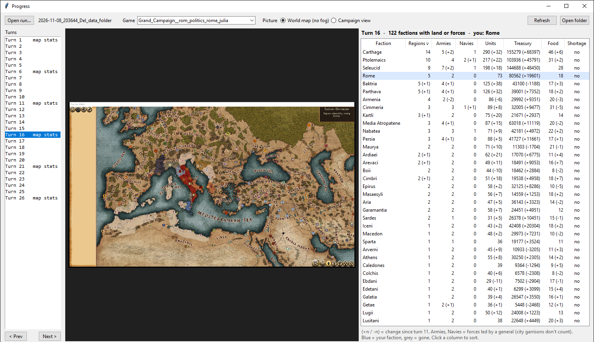
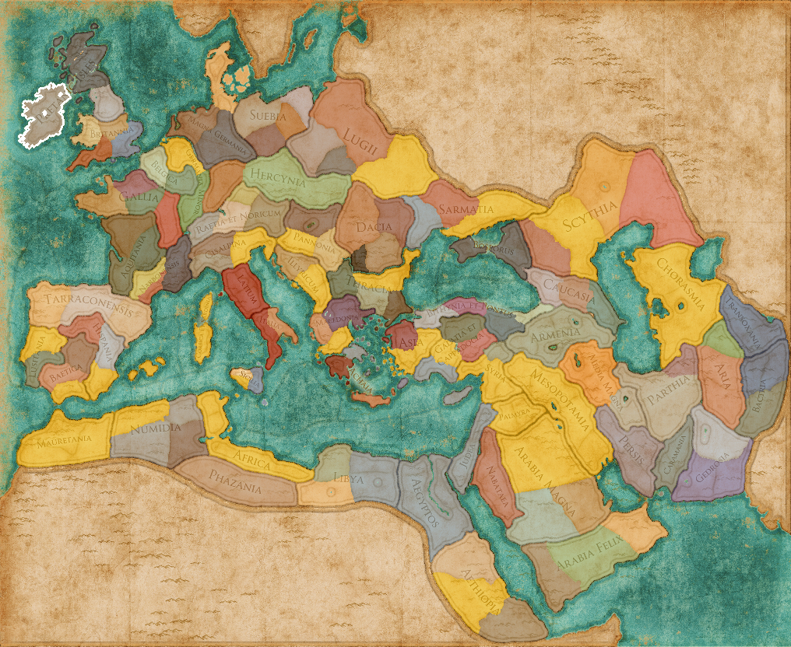

# Rome II Test Runner (rome2-bridge)

A tool for testing **Total War: Rome II** mods. It starts the game by itself, begins a new campaign as the faction
you pick, plays the number of turns you set, and writes down what happened: screenshots, a map of who owns what and
faction numbers every turn, saves, and a crash report when the game crashes to desktop.

Works with **vanilla Rome II** and **Divide et Impera (DeI)**, with or without Consul Scriptum. No Python needed:
one `.exe`.

> **Download:** see [Releases](../../releases). Unzip, start `Rome2TestRunner.exe`, read `README.txt`.



## Screenshots

**Progress window:** DeI, Ebdani (Ireland) in the Grand Campaign with Legio Invicta, turn 31. Pick any turn on the
left: the map of who owns what, with every army (dot) and fleet (square), your faction outlined in white, the faction
clicked in the table in yellow (here Rome), and every faction's numbers (change since the turn before in brackets).



<details>
<summary>The drawn map at full size (turn 31)</summary>



</details>

## What it does

- **Test runs:** one campaign or all of them, one faction or all playable ones, N end turns each. Dialogs are
  answered by themselves (diplomacy declined, war accepted, dilemma option 1, battles autoresolved, captives
  released, intro skipped).
- **Pause / Continue / Stop** a run; the game stays open while paused.
- **Save every N turns** (copied from the autosave to its own file, never Quick Save).
- **Progress window:** each turn's map of who owns what next to a table of every faction (regions, armies, navies,
  units, treasury, food), with the change since the previous turn. Updates live during a run. The map is drawn from
  the region owners on the game's own strategic map (read from your game files, faction colours from the game), so
  it shows the whole map for every faction and campaign, with every faction's armies (dots) and fleets (squares). You can check the map of every turn: pick a turn on the
  left (or Prev / Next, arrow keys), during the run or after it.
- **Game over:** if your faction is wiped out (it only ends turns, so in DeI it can be), the run notices it at once,
  notes "destroyed on turn N" and goes on with the next game.
- **Legio Invicta:** an option that makes your faction's soldiers and ships 100 or 1000 times stronger, so it
  survives long runs. A small mod (no script, no Consul) built in, copied into the game for the run and removed
  after. Tested in DeI, Grand Campaign, Ebdani, 30 turns: wiped out on turn 24 without it, alive to the end with
  either strength. `tools\build_legio_invicta.ps1 -Times N` builds any strength; `testrun --legio N` uses it.
- **Crash report:** when the game crashes, a window tells you where (campaign, faction, which end turn), which mods
  were loaded, and the crash details from the game's crash file.
- **Add your own mods** on top of vanilla or DeI. Mods that edit the startpos file are marked and warned about.
- **Your files are safe:** each run writes its own `user.script.txt`; yours, `preferences.script.txt` and your
  autosave are backed up first and put back afterwards (checked by hash).
- **Bug report:** one zip with what a bug report needs.

## Using the PC during a run

You can. The runner never moves your mouse or types on your keyboard: it clicks the game's buttons from inside the
game, posts the intro's Esc straight to the game window, and screenshots the game window even when it is covered.
Don't click or type in the game window, don't move, resize or minimize it, don't close the game from its own menu or
Task Manager (press Stop Test Run or Quit game: they close the game and put your files back), don't let the PC sleep, and don't change or update mods while a run goes. When a new game starts, the game
window may come to the front, so check where your typing goes. Details in `README.txt`.

## How it works

- `pack/` builds `@rome2_bridge.pack`, a small mod the runner copies into the game's `data` folder for a run (and
  removes afterwards). Its `lua_scripts/all_scripted.lua` is CA's vanilla file plus a short tail that starts
  Consul Scriptum (if installed) and then the bridge.
- `bridge/rome2_bridge.lua` runs inside the game: it answers Lua commands from a file, reads the UI, clicks buttons,
  and writes a heartbeat. It only reads the game and clicks, like a player.
- `rome2bridge/` is the Python side: the library (`core.py`), the test runner (`testrun.py`), the desktop window
  (`gui.py`, `progress.py`), and a command line (`python -m rome2bridge --help`).
- `bridge/rome2_mcp.py` is an MCP server (no dependencies) so any MCP client can control the game.
- `scripts/faction_report.lua` and `scripts/progress_stats.lua` are read-only faction reports.
- `extras/legio_invicta/` is the Legio Invicta mod as text tables (TSV); `tools\build_legio_invicta.ps1` builds
  `@@0_PAW_legio_invicta.pack` from them.

## Command line (from source)

Needs Python 3 on Windows (tested with 3.14; no extra packages) and Rome II from Steam.

```
python -m rome2bridge status
python -m rome2bridge gui
python -m rome2bridge testrun --help
python -m rome2bridge lua "return B.factions()"
python -m rome2bridge click button_ok --ctx some_panel
python -m rome2bridge screenshot shot.png --full
```

- `lua` (and `lua -f file.lua`) runs in the game's global scope with the helpers in `B` (= `ROME2_BRIDGE`):
  `B.find(id, ctx)`, `B.info(c)`, `B.U(c)` (turns a UI address into a component), `B.click`, `B.tree`,
  `B.factions()`, `B.turn()`. The bridge's own local functions (such as `U`) can't be seen from there: use `B.U`.
  `B.find(id, ctx)` (and `click`/`info`/`tree --ctx`) takes the first component named `ctx` anywhere in the UI,
  hidden panels included, then the first `id` inside it, so a name used by several panels can give the wrong one:
  pick a `ctx` whose name is unique, or use `B.find_shown(id, ctx)`, which only finds shown components.
  The game's Lua differs from standard Lua 5.1 here: `s:sub(-400)` on a shorter string gave garbage once and `""`
  after that (seen 2026-11-08, DeI). Keep the start at 1 or more: `s:sub(math.max(1, #s - 399))`.
- Some game calls break the bridge until the game is restarted, so `lua` refuses code that names them:
  `SetImageColour` on a UI component (every value read after it is wrong and the bridge stops), `scroll_camera(` and
  `render_campaign_to_file` (the bridge's timer stops). `Resize`, `MoveTo`, `Position` and `Dimensions` are fine.
- `start` launches the game windowed at 1920x1080 (fullscreen ignores the runner's clicks and can minimize):
  your `preferences.script.txt` is backed up first and `quit` puts it back (unless you changed the display settings
  in between). `--keep-display` launches with your own settings.
- `click`, `info` and `tree` take the parent component only as `--ctx <id>`, not as a second word.
- `hover <id> [--ctx X] [--wait S]` moves the real mouse cursor over a UI component and waits, so its tooltip shows
  in the next `screenshot`. Unlike everything else it uses your mouse and brings the game window to the front.
- `screenshot` saves the game window 968 px wide by default and prints both sizes
  (`window 1936x1119 saved 968x559`). `--full` keeps the window's own size; `--crop LEFT TOP WIDTH HEIGHT` saves a
  part of it at full size, in window pixels (the window's top-left corner, title bar included, is 0 0: the same
  pixels as a `--full` picture).

**Attila and Thrones of Britannia** (2026-11-12, for Consul testing): `--game attila` / `--game tob` (or
`ROME2BRIDGE_GAME`; MCP server: set it in the server's environment). Build their pack with
`tools\build_pack.ps1 -Game attila` / `-Game thrones_of_britannia` (into `pack\build\<game>\`), copy it into that
game's `data` folder and put `mod "@rome2_bridge.pack";` in its `user.script.txt`. Tested in both: start
(`--campaign main_attila` / `vik_attila`), lua, click, panels, end-turn, screenshot, hover, quit, windowed start. ToB
plays a movie after its New Campaign screen (`click button_continue`): the bridge doesn't tick during it, `key` (Esc)
skips it. The test runner (`testrun`, the window) is Rome II only.

The game and settings folders are found by themselves (Steam's library list). If not, set `ROME2_GAME_DIR` /
`ROME2_APP_DIR`, or copy `rome2bridge.example.json` to `rome2bridge.json`.

## Building

- The pack: `tools\build_pack.ps1` (needs [RPFM](https://github.com/Frodo45127/rpfm)'s `rpfm_cli.exe`; set
  `RPFM_CLI` and `ROME2_GAME_DIR` if they are not found).
- Legio Invicta: `tools\build_legio_invicta.ps1` (RPFM plus its Rome II schema `schema_rom2.ron`; set
  `RPFM_SCHEMA` if it is not found).
- The exe: `tools\build_exe.ps1` (makes a private venv with PyInstaller in `build\venv`).

## Credits

- **GooBad** ([bukowa](https://github.com/bukowa)) - [Consul Scriptum](https://github.com/bukowa/ConsulScriptum),
  used here with his permission. The parts of this tool that follow Consul: starting Consul from
  `all_scripted.lua` the same way Consul's own file does, the game-interface lookups of `consul._game()`, the Lua-registry search for `UIComponent`, and the fog of
  war switch (`show_shroud`, as Consul's `/show_shroud`). No Consul files are included.
- **Creative Assembly** - Total War: Rome II; the pack contains the game's vanilla `all_scripted.lua`.
- **Frodo45127** - RPFM, used to build the pack.
- **The Divide et Impera team** - DeI, supported as a base.
- **Legio Invicta** - my own super soldiers mod (PAW), improved with the stat list of the "Virtus" cheat I made
  for Consul Scriptum.

## License

[GNU General Public License v3](LICENSE), like Consul Scriptum. Anyone may use, change and share this tool, with
credit; changed versions must stay under GPL v3 with their source code open.
